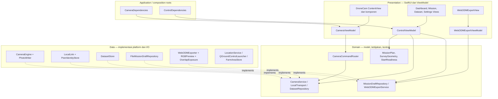

# System Design — DroneCam & Krops / DroneControl

Dokumen ini menjelaskan struktur yang diterapkan pada source code setelah refactor MVVM, 14 Oktober 2026. Diagram referensi digunakan sebagai inspirasi pemisahan tanggung jawab; aplikasi ini memakai repository berkas, bukan SwiftData, karena produk utamanya adalah dataset foto yang dapat diaudit dan dipindahkan.

## Tujuan dan batas sistem

DroneCam mengendalikan kamera iPhone dan menyimpan foto beserta metadata. Krops pada Mac menyiapkan misi, memantau kamera, menerima dataset, dan menyiapkan input WebODM. QGroundControl dibuka sebagai aplikasi terpisah; sistem ini tidak mengirim instruksi navigasi drone atau mengubah source QGroundControl. Rekonstruksi orthomosaic tetap dilakukan di WebODM atau perangkat lunak photogrammetry lainnya.

Prinsip yang dipertahankan:

- Setelah perintah mulai diterima, iPhone memiliki timer, state misi, dan transaksi penyimpanan. Koneksi Mac bukan prasyarat setiap shutter.
- ACK, status kamera, dan keberhasilan penyimpanan merupakan hal berbeda. UI tidak menganggap perintah diterapkan hanya karena pesan berhasil dikirim.
- Foto asli tetap dipertahankan; koreksi warna membuat hasil ekspor terpisah.
- Draft di Mac berbeda dari misi aktif di iPhone. Reconnect tidak menimpa misi yang sedang terbang atau mengulang perintah mulai.
- iOS tetap memerlukan aplikasi kamera terbuka dan layar tidak terkunci. Background, interupsi kamera, dan termination memiliki batas yang berbeda dari putus koneksi.

## Lapisan dan arah dependensi



View menangani layout, binding, pencarian, zoom, disclosure, dan sheet. ViewModel menangani state yang terlihat oleh UI, validasi aksi, dan koordinasi layanan. Domain menangani aturan akuisisi, kontrak layanan, identitas misi, dan DTO. Data menangani AVFoundation, MultipeerConnectivity, ImageIO, filesystem, lokasi, dan pembukaan aplikasi lain.

Ini pemisahan logis dalam dua target Xcode, belum modul Swift Package dengan batas compiler terpisah. Kontrak transport memakai Combine untuk observasi koneksi; kontrak kamera memakai `AVCaptureSession` sebagai handle preview. Model dan perhitungan survei tidak mengimpor SwiftUI, AVFoundation, atau ImageIO. Decoding gambar/EXIF dipisahkan ke `Shared/Data/ImageAssessment.swift`.

Tidak dibuat satu ViewModel untuk setiap kartu pengaturan: survei, kamera, gray card, foto uji, dan pemeriksaan start berbagi state misi yang harus konsisten. `ControlViewModel` menjadi pemilik tunggal state persiapan, sedangkan View setiap fitur tetap terpisah. Ekspor mempunyai ViewModel sendiri karena siklus hidup dan state pekerjaannya berbeda. Batas kebun memakai `FarmAreaViewModel`; pemilihan file tetap pada SwiftUI, parsing/persistensi pada repository.

Panel **Misi** menampilkan area, rencana survei, indikator readiness iPhone dan kontrol capture. Panel **Perangkat** memiliki koneksi, pemilihan misi untuk persiapan perangkat, pengaturan kamera, gray card, foto uji, checklist readiness dan akses setup drone di QGroundControl. State tetap dimiliki `ControlViewModel`, sehingga kembali dari Perangkat ke misi yang sama mempertahankan kalibrasi/review. ACK persiapan tidak mengubah panel yang sedang dibuka dan tidak membatalkan rencana survei yang sudah ditinjau.

## Peta source code

```text
ControlDroneMapping/
  Application/ControlDependencies.swift
  Domain/
    MissionDraftRepository.swift
    WebODMExportService.swift, WebODMExportTypes.swift
    FarmArea.swift, FarmAreaRepository.swift
  Data/
    FileMissionDraftRepository.swift, DemoCameraSimulator.swift
    FarmAreaStore.swift, QGroundControlLauncher.swift
    Export/WebODMExporter.swift, RGBPreview.swift, OverlapExposure.swift
  Presentation/
    ViewModels/ControlViewModel.swift, ControlViewModel+Presentation.swift
    ViewModels/WebODMExportViewModel.swift, FarmAreaViewModel.swift
    Views/ContentView.swift, DashboardView.swift, MissionView.swift
    Views/SurveyConfigurationView.swift, CameraConfigurationView.swift
    Views/PhotoQualityView.swift, CaptureProgressView.swift, MissionFooterView.swift
    Views/DatasetListView.swift, WebODMExportView.swift, AppSettingsView.swift
    Views/DevicesView.swift, DeviceStatusPopover.swift, ConnectionView.swift
    Components/ControlComponents.swift, ControlAppearance.swift, KropsStyle.swift, FarmMap.swift
    ControlNavigation.swift
  ControlDroneMappingApp.swift
DroneMapping/
  Application/CameraDependencies.swift
  Domain/CameraService.swift, CameraCommandRouter.swift
  Data/Camera/CameraEngine.swift, PhotoWriter.swift
  Data/LocationService.swift
  Presentation/CameraViewModel.swift, ContentView.swift
  Presentation/CameraPreview.swift, CameraLinkPanel.swift
  DroneMappingApp.swift
Shared/
  Domain/MappingTypes.swift, SurveyWorkflow.swift
  Domain/Ports/DatasetRepository.swift, LocalTransport.swift
  Data/DatasetStore.swift, LocalLink.swift, PeerIdentityStore.swift, ImageAssessment.swift
  Presentation/MissionStatusComponents.swift
```

Folder synchronized Xcode otomatis memasukkan berkas di bawah root target. `Shared` digunakan kedua target. `Tests` tetap berada di luar target aplikasi dan dijalankan lewat skrip. Mengubah lokasi berkas memerlukan pembaruan input skrip tes.

## Tanggung jawab komponen

| Komponen | Memiliki / mengerjakan | Tidak memiliki |
| --- | --- | --- |
| `ControlViewModel` | Draft, persiapan, review, pending command, korelasi ACK/preview, navigasi operator | Timer shutter dan sesi kamera |
| `CameraViewModel` | Snapshot UI, lifecycle foreground, izin, heartbeat kesehatan, publikasi telemetry/preview | Dedup command atau cadence shutter |
| `CameraCommandRouter` | Cache reply, command in-flight, pemeriksaan foreground dan UUID misi, routing ke kamera/transfer | SwiftUI dan konfigurasi hardware |
| `CameraEngine` | Sesi, konfigurasi, kalibrasi, countdown, scheduler, transisi misi | Discovery atau reconnect |
| `PhotoWriter` | Delegate foto, JPEG/DNG, metadata, journal, commit, preview setelah tersimpan | Perintah remote |
| `LocalLink` | Discovery, pairing, reconnect, pesan, urutan resource transfer | Start/pause otomatis saat koneksi berubah |
| `DatasetStore` | Layout, checksum, manifest, migrasi, recovery, verifikasi | State layar |
| `FileMissionDraftRepository` | Load/save/clear draft secara atomik | Keputusan kapan draft disinkronkan |
| `FarmAreaViewModel` | Snapshot batas kebun, pilihan area, hasil/error import | Parsing GeoJSON atau filesystem |
| `WebODMExportViewModel` | Pilihan referensi/ROI, konfirmasi, progress/result/error, penjadwalan kerja | Algoritma koreksi atau rendering JPEG |
| `WebODMExporter` | Audit dataset, pemilihan mapping, ekspor, laporan, geo.txt | SwiftUI |
| `RGBPreview` / `OverlapExposure` | Sampling warna dan pencocokan overlap | Mission control |

Composition roots membuat implementasi nyata. Pada iPhone, `CameraEngine` dan `LocalLink` menerima instance repository yang sama. ViewModel menerima kontrak; tes dapat menggunakan transport, kamera, draft, dan exporter pengganti tanpa discovery atau shutter nyata. `CameraPreview` dan `FarmMap` adalah adapter View platform, bukan logika misi.

## Isolasi dan concurrency

| Konteks | Tanggung jawab |
| --- | --- |
| Main queue | Published state ViewModel, callback transport, callback hasil command, interaksi SwiftUI dan lifecycle |
| `mapping.camera` serial queue | Semua mutable state akuisisi dan timer di `CameraEngine` |
| `mapping.photo-writer` serial queue | Callback penyimpanan dan commit satu capture |
| `mapping.transfer` utility queue | Hashing, daftar berkas, kirim berurutan, staging/verifikasi penerimaan |
| Export user-initiated queue | Render/koreksi dan ekspor; progress dan hasil kembali ke main queue |

Kontrak kamera dan transport mensyaratkan callback pada main queue. Ini konvensi implementasi, belum keseluruhan enforcement `@MainActor` oleh compiler. `CameraEngine` sengaja mempertahankan state machine di satu pemilik serial agar konfigurasi, countdown, pending delegate, dan pause tidak saling berlomba. Memindahkan kamera ke main queue demi MVVM justru akan mengubah jaminan ini.

`WebODMExportViewModel` menolak pekerjaan kedua saat `working == true` dan mengambil snapshot opsi sebelum bekerja. State hasil/progress read-only untuk View. Menutup sheet ditahan selama ekspor; belum ada cancellation atau background task manager ekspor.

## Alur misi dan reconnect

```mermaid
sequenceDiagram
    actor O as Operator
    participant V as Mac View
    participant VM as ControlViewModel
    participant D as DraftRepository
    participant L as LocalLink
    participant R as CameraCommandRouter
    participant C as CameraEngine
    participant S as DatasetStore
    O->>V: Buat misi bernama, boleh offline
    V->>VM: createMission(name)
    VM->>D: save command dengan UUID
    Note over VM,L: Tunggu koneksi, telemetry segar, kamera siap
    VM->>L: createMission(command UUID)
    L->>R: command
    R->>C: perform
    C->>S: manifest ready
    C-->>R: hasil setelah operasi
    R-->>VM: reply + telemetry + daftar misi
    VM->>D: clear hanya setelah ACK cocok dan accepted
    O->>VM: Survei, kamera, gray card, foto uji, review
    VM->>VM: StartReadiness.evaluate
    VM->>R: start untuk mission UUID aktif
    R->>C: startPrepared
    Note over C,S: Countdown lalu capture/commit lokal
    L--xVM: Koneksi terputus
    Note over C,S: Timer tetap berjalan; tidak ada pause dari link
    L-->>VM: Reconnect, snapshot dan daftar misi
    VM->>R: replyRequestID jika hasil command belum diketahui
    R-->>VM: Cache reply, tanpa menjalankan ulang command
```

State dasar: idle → ready → countdown → capturing. Pause/interupsi/background → paused. Target tercapai atau finish → completed. Error capture/storage atau kondisi kritis → failed. Disconnect bukan transisi state kamera. Resume hanya melalui aksi eksplisit yang valid dan countdown baru.

Draft yang ditolak tetap tersimpan dan memerlukan retry eksplisit dengan command UUID baru. Outcome yang belum diketahui mempertahankan UUID. Cache reply maksimum 256 di proses iPhone; restart menghilangkan cache tersebut. Karena itu sistem tidak menjanjikan exactly-once lintas restart. Recovery merekonsiliasi foto committed dan menandai misi terinterupsi sebagai paused, tanpa otomatis meneruskan shutter.

## Konsistensi pengaturan dan gray card

`settingsApplied` membandingkan pengaturan yang diinginkan, ACK pengaturan, dan telemetry kamera. Mengedit radiometri membatalkan kalibrasi/referensi/review yang relevan; perubahan interval membatalkan review endurance. Preview foto uji dan gray card dicocokkan dengan UUID misi, pengaturan, dan ID command terkait agar foto lama tidak memenuhi readiness misi baru.

Mode panduan menghitung batas shutter/interval dari survei. Gray card 18% membantu metering exposure dan white balance sebelum penerbangan; fokus diuji secara terpisah pada objek bertekstur di jarak kerja. Exposure terkunci selama misi. Referensi pra-terbang bukan sensor cahaya selama penerbangan dan tidak otomatis menormalisasi semua perubahan matahari/awan.

Ekspor memakai satu referensi sebelum terbang yang dipilih operator. ROI harus dikonfirmasi berada pada kartu fisik. Koreksi RGB dan pencocokan exposure overlap tidak mengembalikan highlight terpotong, blur, geometri rolling shutter, atau akurasi GNSS. Overlap tetap eksperimental; JPEG asli dan laporan dipertahankan untuk pembandingan.

## Penyimpanan dan transfer

```text
Documents/DroneMapping/Nama_Misi_tanggal_UUID/
  IMG_000001_UUID.jpg          # JPEG mapping flat
  RAW/IMG_000001_UUID.dng      # bila RAW + JPEG dipilih
  Calibration/IMG_...jpg       # gray card dan quality-test
  Metadata/captureUUID.json
  Metadata/IMG_...metadata.plist
  mission.json
  Exports/.../Images/          # hasil ekspor Mac, bukan input transfer
             References/
             processing-report.json
```

Writer menulis journal pada staging `.pending`, memindahkan foto/sidecar, memeriksa checksum, lalu mempublikasikan indeks JSON atomik. Counter mapping bertambah setelah capture tersimpan; pasangan RAW+JPEG dihitung satu capture. Migrasi dataset lama dan recovery tetap berada di repository.

Resource transfer membawa UUID, hash, relative path, dan nama folder. Path divalidasi; byte foto tidak dikompresi ulang. MCSession temporary file disalin sebelum callback selesai, kemudian diverifikasi di utility queue. `mission.json` dikirim terakhir. Receiver memverifikasi kelengkapan dan hitungan mapping sebelum menyatakan transfer selesai. Transfer terputus dapat diulang; belum byte-range resume atau transaksi seluruh dataset dengan completion ACK lintas perangkat.

Packet tetap version 1; layout capture tetap version 2. Refactor tidak mengubah bundle ID, discovery service, UUID pairing, nama folder, format wire, atau schema berkas. Data lama tidak sengaja dipindah/hapus oleh refactor source code; migrasi runtime yang sudah ada tetap berlaku.

## Pengujian dan cara mengembangkan

| Skrip | Cakupan |
| --- | --- |
| `Scripts/test-core.sh` | Geometri, readiness, scheduler/countdown/reconnect policy, storage, recovery, checksum |
| `Scripts/test-control-flow.sh` | Persiapan manual/panduan, kalibrasi, ACK/preview, draft, identitas misi, operator flow dengan simulator |
| `Scripts/test-dashboard.sh` | Import GeoJSON dan persistensi batas kebun |
| `Scripts/test-webodm-export.sh` | JPEG nyata sintetis, koreksi/overlap, manifest/metadata dan output ekspor |
| `Scripts/test-architecture.sh` | Injected dependencies, dedup dan lookup reply tanpa replay, foreground/UUID guard, draft failure, export reentrancy/error |

Build Mac memvalidasi target `ControlDroneMapping`; build iOS generik tanpa signing memvalidasi target `DroneMapping`. Tes otomatis tidak membuktikan thermal, throughput RAW, GNSS, reconnect radio pada drone, atau hasil rekonstruksi WebODM pada flight block nyata. Prosedur fisik ada pada `DEVICE_TEST_PLAN.md`.

Panduan perubahan:

1. Layout/komponen: ubah View atau `Presentation/Components`; jangan menambahkan I/O ekspor atau perintah kamera langsung di View.
2. Aksi/operator state: ubah ViewModel; aturan fisik start/interval/exposure tetap pada Domain dan diuji.
3. Storage/transport/hardware: ubah implementasi Data melalui kontrak yang ada. Jangan mengikat scheduler ke koneksi.
4. Dependency baru: buat di composition root; gunakan injection untuk tes, bukan singleton baru pada View.
5. Format source memakai konfigurasi `.swift-format`; jalankan `Scripts/format-swift.sh`. Perubahan schema/protokol wajib menyebut kompatibilitas kedua aplikasi dan migrasi dataset.

SDK 27 memberikan deprecation warning untuk MultipeerConnectivity. Refactor ini mempertahankan transport yang telah dipakai; `LocalTransport` menyediakan batas untuk migrasi Network framework terpisah setelah pengujian radio/keamanan. Pemisahan lapisan tidak berarti seluruh implementasi platform sudah diganti atau seluruh pengujian perangkat fisik selesai.

## Waypoint manual dan lokasi operator Mac

Dashboard menampilkan kebun tersimpan di sekitar lokasi operator. `OperatorLocationViewModel` menerima snapshot dari `MacLocationService` melalui `OperatorLocationProviding`; lokasi hanya diminta melalui aksi operator dan tidak dipersistenkan. `FlightPlannerViewModel` mengelola draft rute independen dari MissionPlan iPhone, memakai `FlightRouteRepository`/`FileFlightRouteRepository`. `WaypointMap` menangani klik, seleksi, dan drag pada sheet `FlightPlannerView`; `QGCPlanExporter` menyusun Plan JSON untuk penyimpanan yang dipilih pengguna. Tidak ada upload/arm melalui MAVLink atau perubahan source QGC. [Alur, format, batasan, dan validasi](FLIGHT_PLANNING_AND_MAC_LOCATION.md).
